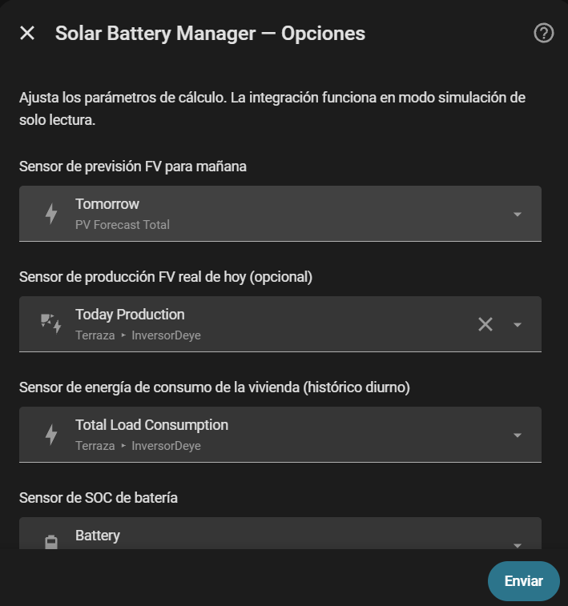
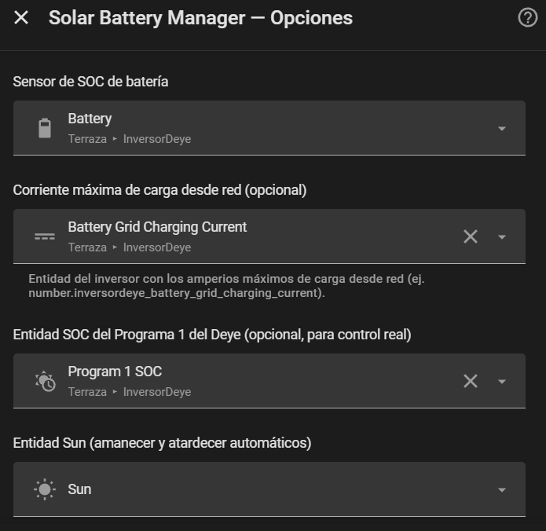
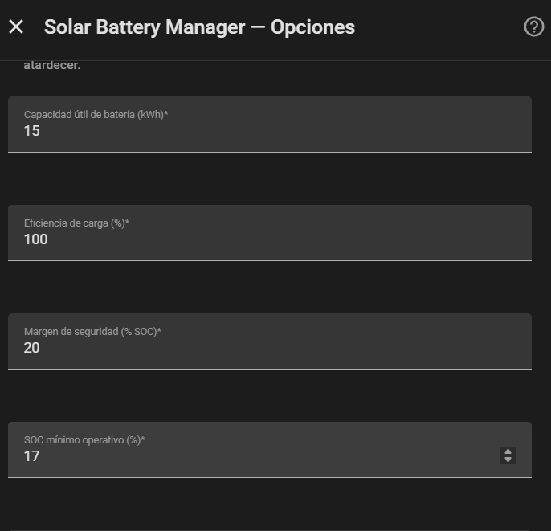
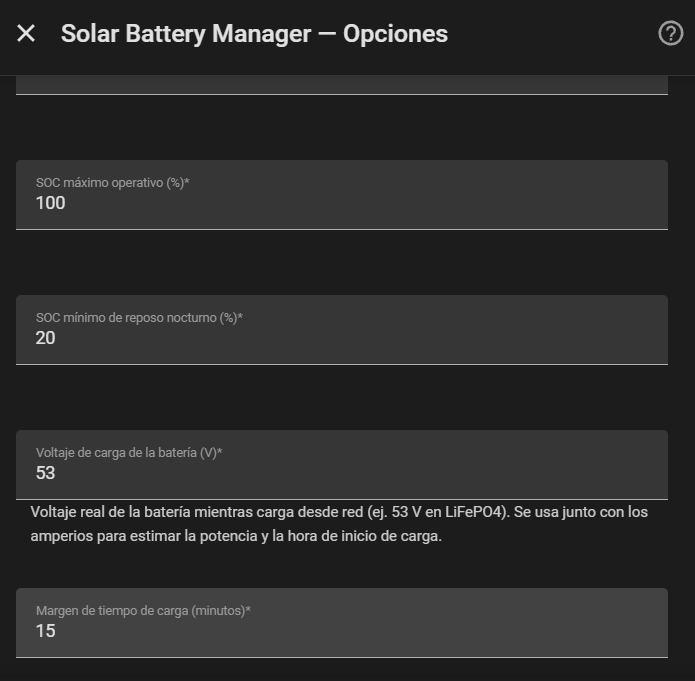
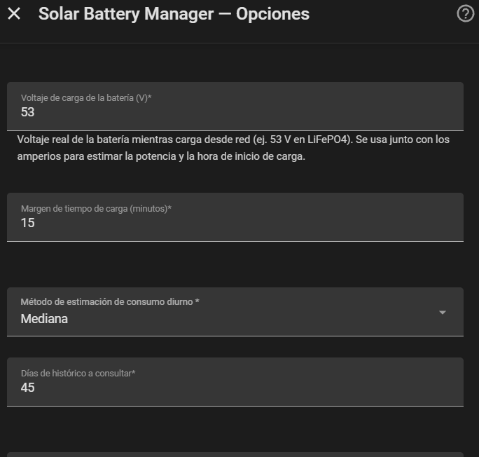
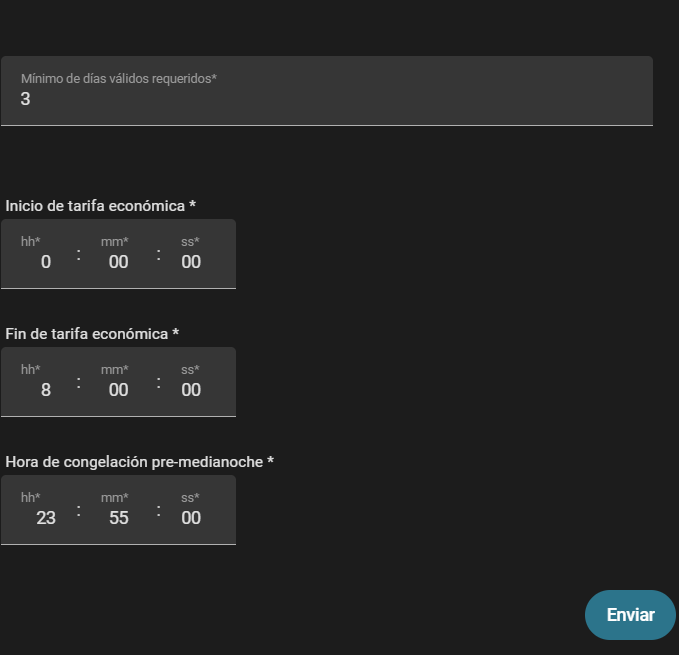

# Configuration Manual — Solar Battery Manager

[🇪🇸 Manual en español](MANUAL.md) · [⬅️ Back to README](README.en.md)

This step-by-step guide explains every configuration option of **Solar Battery Manager** in Home Assistant (*Settings → Devices & services → Solar Battery Manager → Configure*).

---

## 1. Forecast, Production, and Consumption Entities

- **Tomorrow PV forecast sensor**: entity providing expected next-day solar production in `kWh` (or `Wh`), e.g. `sensor.pv_forecast_total_tomorrow`.
- **Today's actual PV production sensor (optional)**: inverter daily PV energy sensor (e.g. `sensor.inversordeye_today_production`). Captured once after sunset to compute the **`PV forecast error`** diagnostic sensor.
- **House load energy sensor (for daytime history)**: house energy consumption sensor with hourly long-term statistics in Home Assistant's `recorder`. Only **daytime solar hours** (sunrise to sunset) are summed, excluding nighttime grid usage.
- **Battery SOC sensor**: current battery state of charge (`%`, e.g. `sensor.inversordeye_battery`).

---

## 2. Inverter Control Entities & `Sun` Window

- **Max grid charging current entity (optional)**: inverter entity with maximum grid charging current in Amps (e.g. `number.inversordeye_battery_grid_charging_current`). Defaults to `25 A` if omitted.
- **Deye Program 1 SOC target entity (optional, for opt-in control)**: inverter `number` entity for the overnight Time-of-Use slot (e.g. `number.inversordeye_program_1_soc`). Only written when **`Real inverter control`** is manually turned `ON` (`OFF` by default).
- **Sun entity (automatic sunrise/sunset window)**: Home Assistant's built-in `sun.sun` entity, used to track local sunrise and sunset automatically across seasons.

---

## 3. Battery & Target SOC Parameters

- **Usable battery capacity (kWh)**: real usable battery capacity in `kWh`.
- **Charge efficiency (%)**: estimated charging efficiency (e.g. `90–100%`). Lower values make calculations more conservative.
- **Safety margin (% SOC)**: extra percentage points added to target SOC to buffer cloud variability or daytime load spikes (e.g. `5–20%`).
- **Minimum operational SOC (%)**: lower calculation bound for target SOC (never modifies BMS protection limits).

---

## 4. Night Idle SOC & Charging Speed

- **Maximum operational SOC (%)**: upper calculation bound (typically `100%`).
- **Night idle SOC (%)**: SOC kept in `Program 1 SOC` outside the off-peak window and overnight **before** the recommended charge start time (e.g. `20%`), allowing normal battery discharge. Must lie between minimum and maximum operational SOC.
- **Battery charging voltage (V)**: real battery voltage while charging from the grid (e.g. `53 V` on 16S LiFePO4 packs). Combined with charging current (`A`) to estimate charging power (`kW`) and start time.
- **Charge time safety buffer (minutes)**: extra lead time (e.g. `15 min`) to account for slower charging near high SOC.

---

## 5. Daytime Load Estimation

- **Daytime load estimation method**:
  - **`Median`** *(recommended)*: resilient against occasional appliance spikes.
  - **`Mean`**: arithmetic mean across valid days.
- **History lookback (days)**: number of past days queried from `recorder` hourly statistics (`3`–`60` days).

---

## 6. Off-Peak Tariff & Freeze Schedule

- **Minimum valid history days**: minimum days with ≥ 75% valid solar-window hours required for a valid calculation (default `3`). Fewer days trigger fail-safe mode.
- **Economic tariff start**: start of the off-peak grid window (e.g. `00:00:00`).
- **Economic tariff end**: deadline by which target SOC should be reached (e.g. `08:00:00`).
- **Pre-midnight target freeze time**: time when the nightly target SOC is frozen and persisted (e.g. `23:55:00`) to avoid midnight sensor resets altering the plan.

---

## 7. Simulation vs. Real Control

1. After clicking **Submit**, the integration starts in **simulation mode** (`Real inverter control = OFF`).
2. Confirm **`Calculation ready`** is on and observe **`Target SOC at 08:00`**, **`Recommended charge start`**, and **`PV forecast error`** over several days.
3. Once validated—and after verifying your inverter's *Time of Use* `Program 1` (`00:00–08:00`, `Grid`)—you can enable **`Real inverter control`**. Every automatic SOC update will appear directly in the device's **Activity** log.
