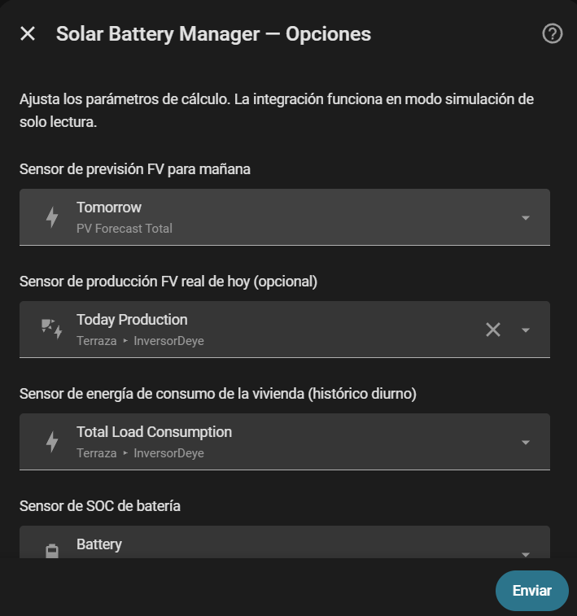
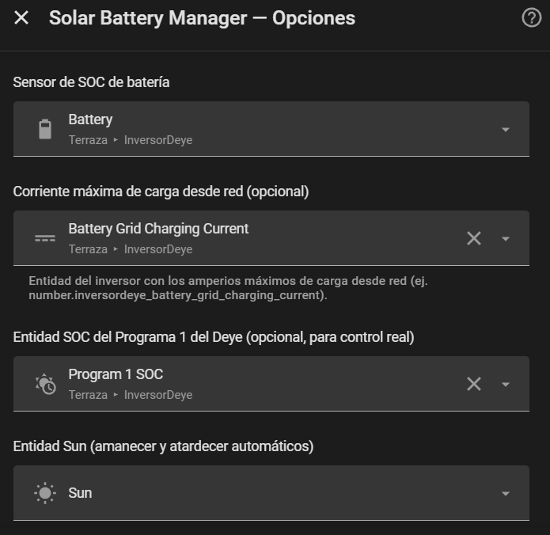
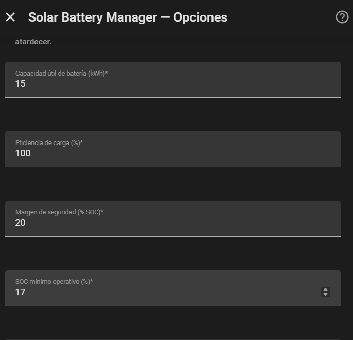
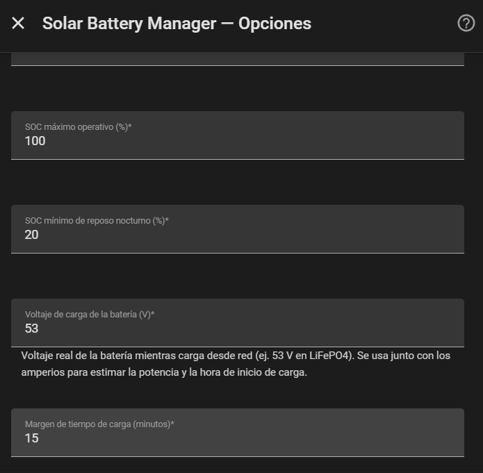
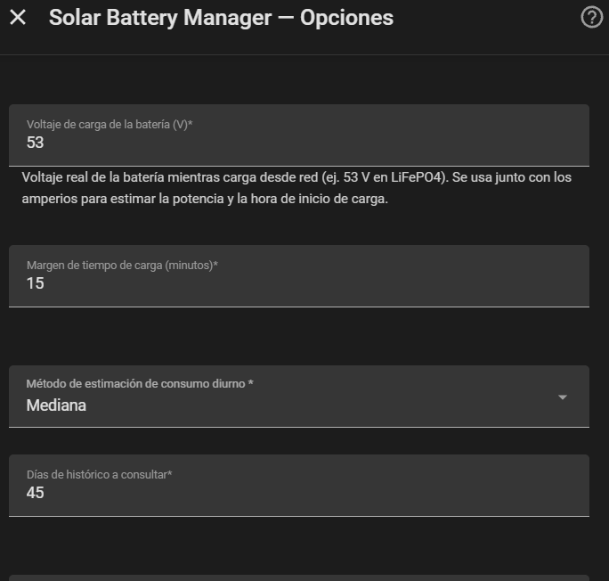
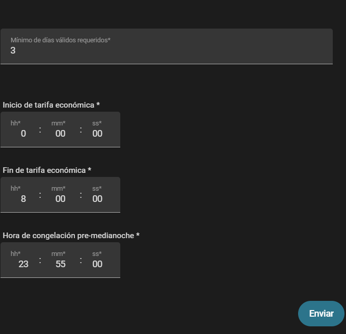

# Manual de configuración — Solar Battery Manager

[🇬🇧 English manual](MANUAL.en.md) · [⬅️ Volver al README](../README.md)

Esta guía explica paso a paso todos los parámetros de configuración de **Solar Battery Manager** en Home Assistant (*Ajustes → Dispositivos y servicios → Solar Battery Manager → Configurar*).

---

## 1. Entidades de previsión, producción y consumo

- **Sensor de previsión FV para mañana**: entidad que indica los `kWh` (o `Wh`) de producción solar previstos para el día siguiente (p. ej. `sensor.pv_forecast_total_tomorrow`).
- **Sensor de producción FV real de hoy (opcional)**: contador diario de producción fotovoltaica del inversor (p. ej. `sensor.inversordeye_today_production`). Si se configura, la integración captura la producción al atardecer y alimenta el sensor diagnóstico **`Error de previsión FV`**.
- **Sensor de energía de consumo de la vivienda (histórico diurno)**: sensor de consumo eléctrico de la vivienda con estadísticas horarias en el `recorder` de Home Assistant (p. ej. `Total Load Consumption`). La integración suma **únicamente las horas solares** (amanecer–atardecer), ignorando el consumo nocturno.
- **Sensor de SOC de batería**: porcentaje actual de carga de la batería (`%`, p. ej. `sensor.inversordeye_battery`).

---

## 2. Entidades de control del inversor y ventana solar (`Sun`)

- **Corriente máxima de carga desde red (opcional)**: entidad del inversor con los amperios máximos de carga desde red (p. ej. `number.inversordeye_battery_grid_charging_current`). Si se deja vacía, se asumen `25 A` por defecto.
- **Entidad SOC del Programa 1 del Deye (opcional, para control real)**: entidad `number` del tramo nocturno del inversor (p. ej. `number.inversordeye_program_1_soc`). Solo se utiliza si activas manualmente el interruptor **`Control real del inversor`** (`OFF` por defecto).
- **Entidad Sun (amanecer y atardecer automáticos)**: entidad de la integración nativa **Sun** (`sun.sun`). Se usa para obtener automáticamente la hora local de amanecer y atardecer durante todo el año.

---

## 3. Parámetros de batería y cálculo del SOC objetivo

- **Capacidad útil de batería (kWh)**: capacidad real utilizable de tu batería en `kWh`. Ajusta este valor según tu instalación (no asumas automáticamente la capacidad nominal si reservas parte del SOC).
- **Eficiencia de carga (%)**: rendimiento estimado al almacenar excedente solar o cargar desde red (p. ej. `90–100 %`). Un valor más bajo hace el cálculo más conservador.
- **Margen de seguridad (% SOC)**: puntos porcentuales extra que se suman al SOC objetivo para cubrir imprevistos de nubosidad o picos puntuales de consumo diurno (p. ej. `5–20 %`).
- **SOC mínimo operativo (%)**: límite inferior de cálculo para el SOC objetivo. Nunca modifica las protecciones internas del BMS.

---

## 4. Reposo nocturno y velocidad de carga

- **SOC máximo operativo (%)**: tope superior para el SOC objetivo (normalmente `100 %`).
- **SOC mínimo de reposo nocturno (%)**: porcentaje que se mantiene en `Program 1 SOC` fuera de la ventana económica y durante la noche **antes** de que llegue la hora recomendada de inicio de carga (p. ej. `20 %`), permitiendo que la vivienda descargue la batería normalmente. Debe estar entre el SOC mínimo y el máximo operativo.
- **Voltaje de carga de la batería (V)**: voltaje real al que trabaja tu batería mientras carga desde red (p. ej. `53 V` en baterías LiFePO4 de 16 celdas). Se multiplica por los amperios configurados para estimar la potencia real de carga (`kW`) y calcular la hora de inicio.
- **Margen de tiempo de carga (minutos)**: colchón adicional de tiempo (p. ej. `15 min`) que adelanta el inicio de carga para compensar la ralentización en la fase final de carga.

---

## 5. Estimación de consumo diurno

- **Método de estimación de consumo diurno**:
  - **`Mediana`** *(recomendado)*: ignora días atípicos con picos de consumo puntual (lavadora, horno, etc.).
  - **`Media`**: promedio aritmético de los días válidos.
- **Días de histórico a consultar**: cuántos días hacia atrás consulta en las estadísticas horarias del `recorder` (entre `3` y `60` días; p. ej. `14` o `45`).

---

## 6. Horarios de tarifa económica y congelación

- **Mínimo de días válidos requeridos**: número mínimo de días con histórico completo (≥ 75 % de las horas solares) necesarios para dar el cálculo por válido (por defecto `3`). Si hay menos, la integración falla de forma segura y no ordena carga.
- **Inicio de tarifa económica**: hora a la que empieza la ventana barata de red (p. ej. `00:00:00`).
- **Fin de tarifa económica**: hora límite a la que debe alcanzarse el SOC objetivo (p. ej. `08:00:00`).
- **Hora de congelación pre-medianoche**: momento en el que se congela y guarda en disco el SOC objetivo de la noche (p. ej. `23:55:00`) para evitar que los reinicios diarios de sensores a medianoche alteren el objetivo.

---

## 7. Modo simulación vs. Control real

1. Tras pulsar **Enviar**, la integración arranca siempre en **modo simulación** (`Control real del inversor = OFF`).
2. Comprueba en la página del dispositivo que **`Cálculo listo`** está encendido (`Ejecutando`) y observa durante varios días el **`SOC objetivo a las 08:00`**, la **`Hora de inicio de carga recomendada`** y el **`Error de previsión FV`**.
3. Cuando estés conforme con las estimaciones y hayas verificado que tu inversor tiene *Time of Use* activo en `Program 1` (`00:00–08:00`, `Grid`), puedes activar el interruptor **`Control real del inversor`**. Cada cambio automático de SOC quedará registrado en el panel **Actividad** del dispositivo.
